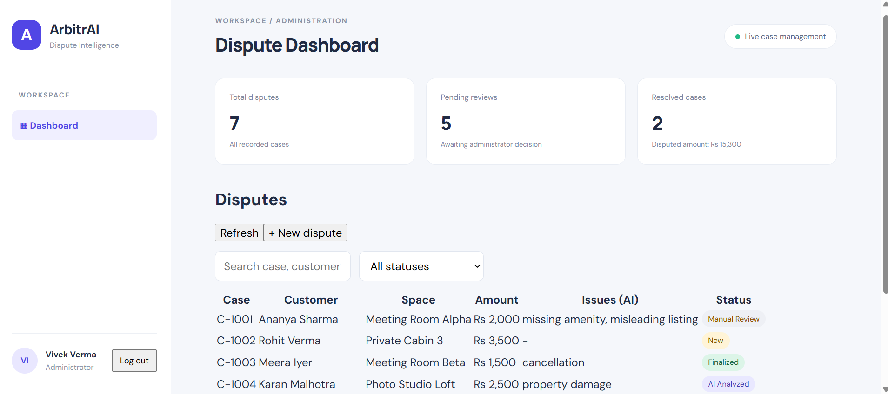
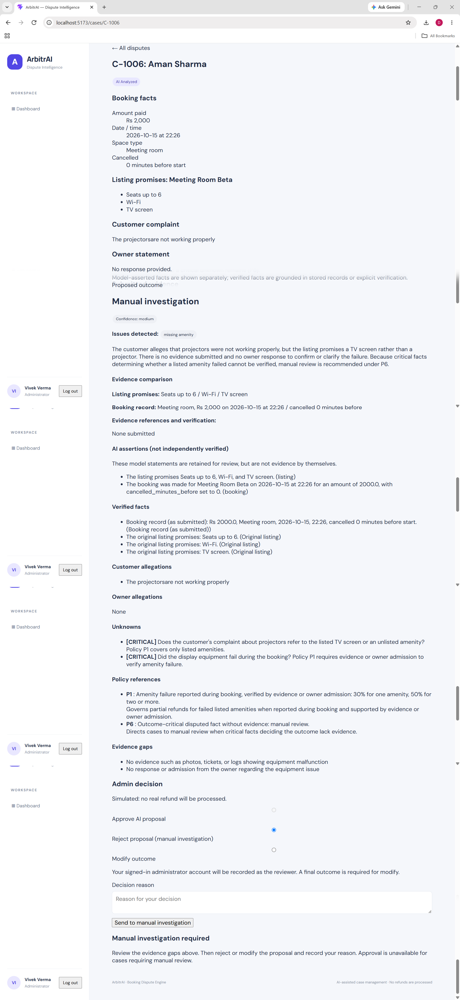
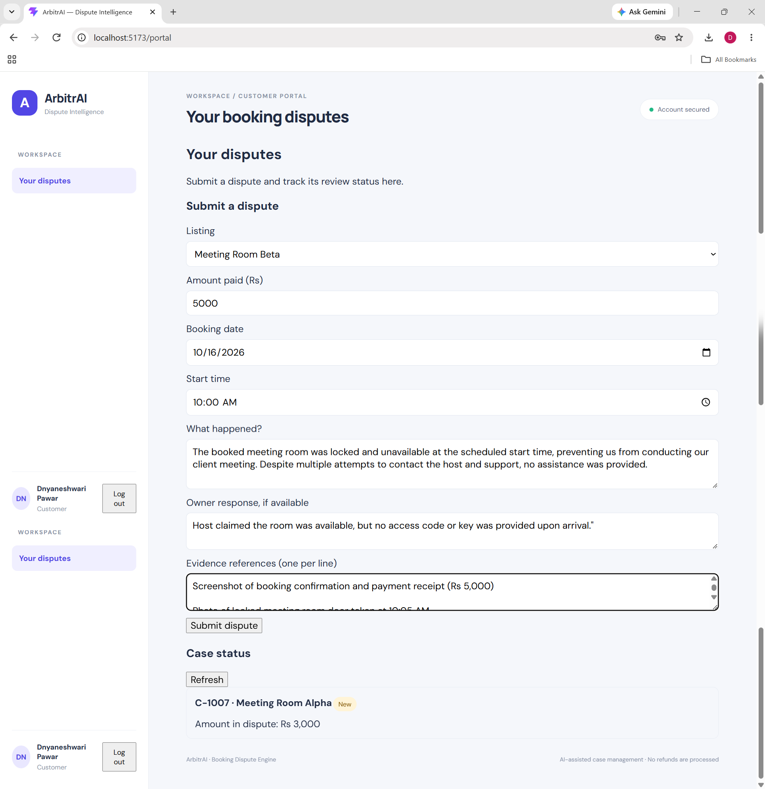

# ArbitrAI — AI Booking Dispute & Resolution Engine

An admin console that uses **Google Gemini** to investigate coworking-marketplace booking disputes and **propose** a resolution. Deterministic Python guardrails check every proposal against a written policy, and a **human administrator makes the final decision**. No payments, refunds or messages are ever sent.

> Take-home demonstration project. All decisions are simulated.

---

## Table of contents

1. [Quick start](#quick-start)
2. [How it works](#how-it-works)
3. [Guardrails](#guardrails)
4. [Seeded dispute scenarios](#seeded-dispute-scenarios)
5. [Assignment coverage](#assignment-coverage)
6. [Setup](#setup)
7. [Using the app](#using-the-app)
8. [Handling uncertain or conflicting evidence](#handling-uncertain-or-conflicting-evidence)
9. [AI limitations](#ai-limitations)
10. [Design choices](#design-choices)
11. [Project structure](#project-structure)
12. [API overview](#api-overview)
13. [Environment variables](#environment-variables)
14. [Tests](#tests)
15. [Known limitations](#known-limitations)

---

## Quick start

Requires Python 3.10+ (tested on 3.13), Node.js 20.19+ or 22.12+, and a [Gemini API key](https://aistudio.google.com/apikey).

```powershell
# 1. Backend (from project root, Windows PowerShell)
py -3 -m venv Backend\.venv
Backend\.venv\Scripts\python.exe -m pip install -r Backend\requirements.txt
Copy-Item Backend\.env.example Backend\.env      # then set GEMINI_API_KEY
Set-Location Backend
.\.venv\Scripts\python.exe -m auth provision-admin   # one-time admin account
.\.venv\Scripts\python.exe -m uvicorn main:app --reload
```

```powershell
# 2. Frontend (second terminal, from project root)
Set-Location Frontend
npm.cmd install
npm.cmd run dev
```

Open <http://localhost:5173>, sign in as the admin you created, and open **C-1001**. Click **Analyze with AI**.

<details>
<summary>macOS / Linux commands</summary>

```bash
python3 -m venv Backend/.venv
Backend/.venv/bin/pip install -r Backend/requirements.txt
cp Backend/.env.example Backend/.env             # then set GEMINI_API_KEY
cd Backend
.venv/bin/python -m auth provision-admin
.venv/bin/python -m uvicorn main:app --reload

# second terminal
cd Frontend && npm install && npm run dev
```
</details>

---

## How it works

```
Customer / Admin ──► React + Vite ──► FastAPI ──► Gemini (structured JSON)
                                         │              │
                                         │              ▼
                                         │      Pydantic schema validation
                                         │              │
                                         │              ▼
                                         │      Policy guardrails (Python)
                                         ▼              │
                                   JSON storage ◄───────┘
                                         ▲
                              Admin: approve / reject / modify
```

1. A customer (or admin) submits a dispute: booking details, complaint, optional evidence references.
2. An admin opens the case and clicks **Analyze with AI**. The backend sends the policy, listing, booking, complaint, owner response and evidence references to Gemini.
3. Gemini must return **schema-enforced JSON**: issue categories, facts, allegations, unknowns, policy references, a recommendation, confidence and evidence gaps.
4. Python validates the schema, then runs the guardrails. A guardrail can correct a percentage or force **manual review**, and every override is shown to the admin.
5. The admin **approves**, **rejects** (sends to manual investigation) or **modifies** the proposal with a written reason. The reviewer identity comes from the signed-in session.
6. The decision, the original AI proposal and an audit entry are stored. Nothing is paid out.

**Case status flow:** `New → AI Analyzed → (Manual Review) → Finalized`

---

## Guardrails

The model proposes; code decides what is allowed. Guardrails live in `Backend/guardrails.py`.

| Guardrail | Behaviour |
| --- | --- |
| Policy as source of truth | Only clauses P1–P6 in `Backend/policies.md` can be cited. Unknown clause IDs are removed. |
| Cancellation (P3) | The refund percentage is **computed in code** from the booking record, not trusted from the model. |
| Amenity failure (P1) | Needs a specific failure confirmed by an explicit owner admission or administrator-verified evidence, and a report during the booking. Allowed refunds: 30% (one amenity) or 50% (two or more). |
| Access failure (P2) | Full refund only when denied access is established and no equivalent space was accepted. |
| Property damage (P4) | Requires verified photos or timestamped evidence, otherwise manual review. |
| Noise (P5) | Refund only if the listing promised quiet **and** noise is evidenced. No quiet promise means no refund. |
| Insufficient evidence (P6) | An unresolved, outcome-critical unknown forces manual review. |
| Low confidence | Low model confidence forces manual review. |
| Percent/outcome consistency | A refund percentage must match a supporting policy clause and issue category. |
| Mandatory review wins | Manual-review conditions are applied last, so the model cannot override them. |
| Facts vs claims | "Verified facts" are built from stored records and explicit verification. The model's own assertions are shown separately as **AI assertions (not independently verified)**. |
| Human approval | No outcome is final until an administrator records a decision. |

---

## Seeded dispute scenarios

`Backend/data.example.json` contains five scenarios covering every challenge in the brief.

| Case | Scenario | Expected outcome | Policy |
| --- | --- | --- | --- |
| C-1001 | Projector failed, Wi-Fi disputed | **30% partial refund** for the admitted projector fault; the disputed Wi-Fi claim is not verified | P1 |
| C-1002 | Denied access to a reserved cabin (double-booked) | **100% full refund** | P2 |
| C-1003 | Cancelled 30 minutes before start | **0% no refund** (computed in code) | P3 |
| C-1004 | Owner claims damaged furniture, no evidence | **Manual review** (insufficient evidence) | P4, P6 |
| C-1005 | Noise on an open-plan floor, no quiet promise | **No refund** | P5 |

`C-1004` is the required "insufficient evidence → manual review" case. Because Gemini output can vary, the guardrails keep these outcomes consistent regardless of model wording.

---

## Assignment coverage

| Requirement | Where it is implemented |
| --- | --- |
| Dispute intake | Customer portal and admin intake form (booking details, complaint, optional evidence references) |
| AI issue extraction | `issue_categories` in the structured AI output |
| Facts vs allegations vs unknowns | Separate colour-coded panels in the AI investigation view |
| Evidence and policy comparison | Evidence comparison panel (listing promises, booking record, evidence references with verification status) plus cited policy rules |
| Resolution proposal | Full refund, partial refund, no refund or manual investigation, with explanation, policy references, evidence gaps and confidence |
| Admin approve / reject / modify | Decision controls with a mandatory written reason; reject sends the case to manual investigation |
| Simulated actions only | Every decision is stored as `simulated: true`; no payment or messaging code exists |
| Screens | Dashboard (status and amount), case detail, AI investigation panel, decision controls with visible status |
| Structured AI output | Gemini JSON schema, validated with Pydantic (`extra="forbid"`) |
| At least three mock disputes | Five seeded cases, including one manual-review case |
| Draft decision messages (optional) | Deterministic customer and owner drafts for finalized cases, labelled "not sent" |

---

## Setup

### Prerequisites

- Python 3.10+ (tested on 3.13)
- Node.js 20.19+ or 22.12+ (tested on 24) and npm
- A Gemini API key for live analysis

### Backend (Windows PowerShell, from project root)

```powershell
py -3 -m venv Backend\.venv
Backend\.venv\Scripts\python.exe -m pip install -r Backend\requirements.txt
Copy-Item Backend\.env.example Backend\.env
notepad Backend\.env
```

Set `GEMINI_API_KEY` in `Backend\.env`. Never commit it. `.env`, virtual environments, `node_modules`, build output and the runtime `data.json` are all gitignored.

### Create the administrator

```powershell
Set-Location Backend
.\.venv\Scripts\python.exe -m auth provision-admin
```

You are prompted for an email, display name and a password of 12–72 characters. The command refuses to create a second admin. No credentials are stored in the repository. Public registration only creates **customer** accounts.

### Run

```powershell
# Backend terminal (inside Backend/)
.\.venv\Scripts\python.exe -m uvicorn main:app --reload

# Frontend terminal (inside Frontend/)
npm.cmd install
npm.cmd run dev
```

- App: <http://localhost:5173> (Vite picks the next port if 5173 is busy; use the URL it prints)
- API docs (Swagger): <http://127.0.0.1:8000/docs>

On first run the backend copies `data.example.json` to the ignored runtime file `Backend/data.json`. Delete `data.json` to reset to the seeded state (this also removes accounts and sessions).

---

## Using the app

### Customer

1. Register at `/register` and sign in.
2. Submit a dispute: listing, amount, date, time, complaint, and optional evidence references.
3. Track your own cases and their status. Customers cannot see other customers' cases, AI analysis or internal notes.

### Administrator

1. Sign in at `/login`. The dashboard shows stats, search and status filters.
2. Open a case and compare the booking record, listing promises, customer complaint, owner statement and evidence references.
3. Click **Analyze with AI** and review the proposed outcome, facts, allegations, unknowns, policy references, evidence gaps and any guardrail notes.
4. Optionally record an evidence verification (what you inspected and which claim it supports).
5. **Approve** an eligible proposal, **reject** it for manual investigation, or **modify** it, always with a written reason.
6. After finalizing, review the stored decision, the original AI proposal, the audit history and the draft customer and owner messages.

Approve is unavailable when the proposal is manual review. A rejected proposal stays in **Manual Review** until a separate final outcome is recorded.

---

## Handling uncertain or conflicting evidence

- **References are not proof.** Submitted evidence is stored as references only. A filename or description is never treated as verified, and the UI labels it "Reference only; contents not inspected".
- **Verification is explicit.** Only an administrator's recorded verification (type, supported claim, reviewer, timestamp) promotes evidence to a verified fact. It records who reviewed an item, not independent proof of authenticity.
- **Both sides are preserved.** Customer and owner statements are shown separately as allegations until supported.
- **Admissions are narrow.** An owner admission verifies only the specific fact admitted, such as the projector fault, and not the whole complaint.
- **Critical unknowns win.** If an outcome-critical fact is disputed and unsupported, the proposal becomes **manual review** (P6), whatever the model suggested.
- **Failures never default to a refund.** Provider errors, quota limits or malformed output stop the analysis with a clear, retryable message.

---

## AI limitations

- Gemini can misread narrative, miss context or return incomplete output. Its result is a **proposal only**.
- The model cannot open evidence files. It sees only the text of references, which is why they are never trusted as proof.
- Self-reported confidence is a signal, not a measurement.
- Guardrails validate policy references, allowed percentages and evidence gates. They cannot establish whether evidence is authentic or replace administrator judgment.
- Owner-admission detection uses explicit wording rules. An unusual phrasing is treated conservatively and leads to manual review.
- The policy is a mock document and would need legal review in production.
- Provider unavailability, an invalid key or exhausted quota produces an error, not a substitute analysis.

---

## Design choices

- **Gemini proposes, Python decides.** Extraction and drafting come from the model. Percentages, evidence gates and final validation are deterministic code.
- **Structured output.** The response schema is enforced at the model call and again by Pydantic, so the UI renders typed fields rather than free text.
- **Conservative by default.** When in doubt, the system escalates to manual review instead of guessing.
- **Auditability.** Proposal history, decision snapshots, reviewer identity and timestamps are stored for every case.
- **Role separation.** Admin-only analysis, statistics, evidence verification and decisions; customers see only their own cases.
- **Simple storage.** A JSON file with atomic writes and an in-process lock keeps the demo easy to run and inspect.
- **Deterministic message drafts.** Customer and owner drafts are generated from the final outcome and cited clauses without another LLM call, and are never sent.

---

## Project structure

```
.
├── README.md
├── Backend/
│   ├── main.py              # FastAPI routes, access control, decision logic
│   ├── ai.py                # Prompt, Gemini call, retries, error categories
│   ├── guardrails.py        # Deterministic policy checks on AI output
│   ├── models.py            # Pydantic models, including the AI output contract
│   ├── auth.py              # bcrypt hashing, sessions, admin provisioning CLI
│   ├── storage.py           # Atomic JSON persistence and write lock
│   ├── policies.md          # Marketplace policy P1–P6 (source of truth)
│   ├── data.example.json    # Seeded listings and five disputes
│   ├── requirements.txt
│   ├── .env.example
│   └── tests/test_disputes.py
└── Frontend/
    └── src/
        ├── App.jsx, api.js, outcomeLabels.js
        ├── pages/           # AuthPage, CaseList, CaseDetail, CustomerPortal
        └── components/      # AIPanel, DecisionControls
```

---

## API overview

All routes are under `/api`. The full, interactive list is at `/docs`.

| Method | Route | Access | Purpose |
| --- | --- | --- | --- |
| POST | `/auth/register` | Public | Create a customer account |
| POST | `/auth/login` · `/auth/logout` | Public / signed in | Start or end a session |
| GET | `/auth/me` | Signed in | Current user |
| GET | `/listings` | Signed in | Listings and promises |
| GET / POST | `/cases` | Signed in | List (own cases for customers) or create a case |
| GET | `/cases/{id}` | Signed in | Case detail (customers get a restricted view) |
| POST | `/cases/{id}/analyze` | Admin | Run Gemini analysis and guardrails |
| POST | `/cases/{id}/decision` | Admin | Approve, reject or modify |
| GET | `/stats` | Admin | Dashboard totals |

Evidence verification and draft-message endpoints are also admin-only; see `/docs`.

---

## Environment variables

| Variable | Used by | Purpose |
| --- | --- | --- |
| `GEMINI_API_KEY` | Backend | **Required** for analysis. Keep it in `Backend/.env`. |
| `GEMINI_MODEL` | Backend | Model name. Defaults to `gemini-2.5-flash`. |
| `ARBITRAI_COOKIE_SECURE` | Backend | Set to `1` / `true` / `yes` for HTTPS secure cookies. Unset for local HTTP. |
| `VITE_API_TARGET` | Frontend | Optional proxy target. Defaults to `http://127.0.0.1:8000`. |

---

## Tests

```powershell
# Backend (from project root)
Backend\.venv\Scripts\python.exe -m unittest discover -s Backend\tests

# Frontend
Set-Location Frontend
npm.cmd run build
npm.cmd run lint
```

Backend tests mock Gemini, so no API key is needed. They cover the five seeded scenarios, policy and evidence guardrails, malformed or failed AI responses, password hashing, authentication and ownership checks, decision finalization, audit history and JSON persistence. Passing tests do not prove the live Gemini integration works; run a real analysis once to confirm your key and model.

---

## Known limitations

- JSON storage is for a single-instance demo, not concurrent or multi-process production use.
- No password reset, email verification or rate limiting, and no independent security audit.
- Accounts and sessions are lost if `Backend/data.json` is deleted.
- Booking details entered at intake are treated as the booking record; a real system would read them from the booking platform.
- Evidence is referenced, not uploaded or machine-verified.
- Set `ARBITRAI_COOKIE_SECURE=1` when serving over HTTPS.

---

## Screenshots
**1. Dashboard**


**2. AI investigation and decision**


**3. Customer portal**


*ArbitrAI is a demonstration project. It does not process real payments or refunds and does not replace human judgment.*
